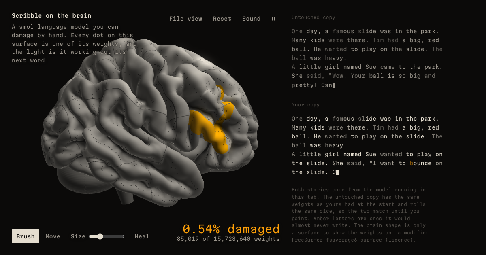

# Scribble on the brain

A smol language model you can damage by hand. **[scribble.narasim.me](https://scribble.narasim.me/)**

The model is a PNG. Every pixel is one weight, and the page runs the model
straight from the image in your browser. The image is wrapped on a brain so
you can paint on it. Paint, and the weights under the brush are scrambled:
the story it is writing starts to misspell, then falls apart. Heal puts the
weights back.

## What is real

Everything on the page comes from the model. Nothing is faked for effect.

- **The model.** A GPT with one-bit weights (each is +1 or -1 times a scale),
  trained on TinyStories. 15,728,640 one-bit weights in 5 layers, plus about
  410,000 ordinary numbers for the embeddings and gains.
- **The picture.** A 4096 x 4096 one-bit PNG, 2.8 MB. White is +1, black is
  -1. The ordinary numbers ride in a private chunk of the same file, so one
  file is the whole model. Open `brain.png` in any image viewer to see it.
- **The engine.** TypeScript with a small Rust kernel compiled to
  WebAssembly (912 bytes). It reads the weights from the picture's bits and
  matches the PyTorch model's output within 1e-3.
- **The two stories.** "Yours" is the model you paint on. The "twin" has the
  untouched weights and rolls the same dice, so the two match until you
  paint. Amber marks what the twin would give less than one chance in fifty.
- **The light and the sound.** The light is each square's activity as the
  model computes its next piece of text. The sound is one key click per
  letter, a jammed key for amber, and a scratch for the brush.
- **The brain shape** is only a surface to show the weights on. It has
  nothing to do with the model.

## What I measured

- 0.605 bits per character on held-out stories after 12 hours on an M2 Max.
- About 3 ms per token in the browser on the same machine.
- Where you paint matters more than how much. Layers run from the forehead
  to the back of the head. Randomizing one square of layer 1's attention
  takes the model from 0.59 to about 3.3 bits per character, which is
  gibberish. Randomizing any of the 20 "mlp out" squares barely changes it
  (0.61 to 0.63).
- With random damage everywhere: about 1% of weights flipped keeps it fluent
  but changes the story, 2 to 3% breaks words, 5% leaves fragments.

## Run the page

Needs [Bun](https://bun.sh).

    cd web
    bun install
    bun run data     # downloads the trained model picture and brain mesh (13 MB)
    bun run dev

Other commands: `bun test` checks the engine against PyTorch's answers,
`bun run build` type-checks and bundles, `bun run kernel` rebuilds the
WebAssembly kernel from `web/kernel` (needs Rust).

## Train your own

Needs [uv](https://docs.astral.sh/uv/). The 16M model took 12 hours on an
M2 Max; a 4M one that still writes stories takes 2.

    cd train
    uv sync
    uv run python data.py                  # download and encode TinyStories
    uv run python train.py --vocab bpe512 --name mine --minutes 120
    uv run python sample.py mine --flip 0 0.01 0.03 0.05   # stories, healthy and damaged
    uv run python lesion.py mine           # which part of the model matters
    uv run python export.py mine           # write runs/mine/brain.png
    cp runs/mine/brain.png ../web/public/data/

The brain mesh is built by `web/tools/build_mesh.py` (see the top of that
file).

## Layout

| Folder | What |
|---|---|
| `train/` | Python: the tokenizer, the one-bit model, training, damage tests, export to PNG |
| `web/src/model/` | The engine that runs the model from its picture. No browser needed. |
| `web/src/worker/` | Runs the model off the main thread and takes paint strokes |
| `web/src/view/` | The 3D brain, in three.js |
| `web/src/audio/` | The sounds, synthesized from model state |
| `web/kernel/` | The Rust inner loop |
| `bench/` | The benchmark behind the choice of kernel |

## Licence and credits

The code is under the MIT licence (`LICENSE`).

The model is trained on [TinyStories](https://huggingface.co/datasets/roneneldan/TinyStories)
by Ronen Eldan and Yuanzhi Li, which is released under CDLA-Sharing-1.0.

The brain shape is a modified version of FreeSurfer's fsaverage6 surface,
used under the FreeSurfer Software License
(`web/public/licenses/fsaverage.txt`).
